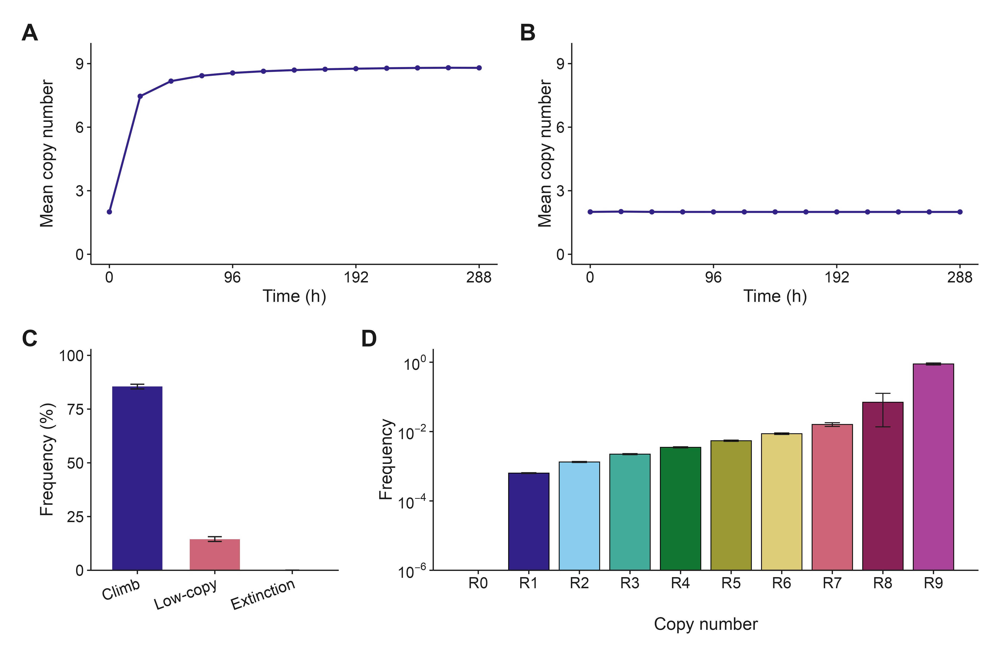
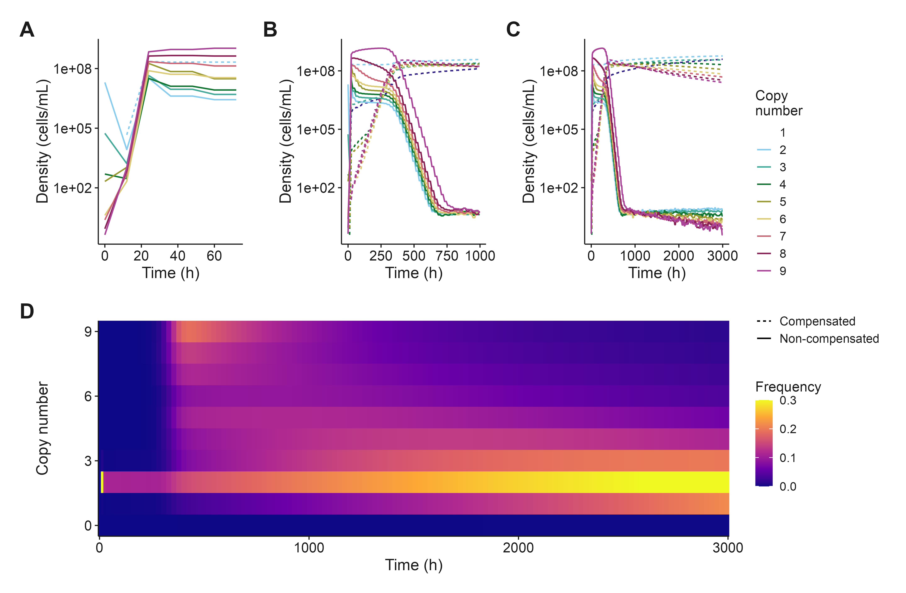
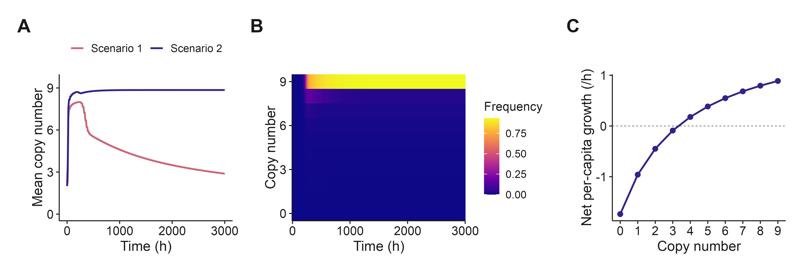
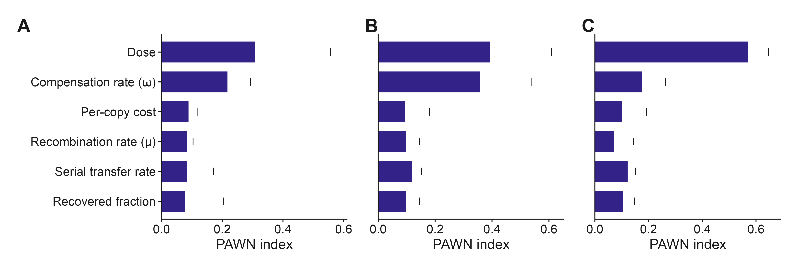
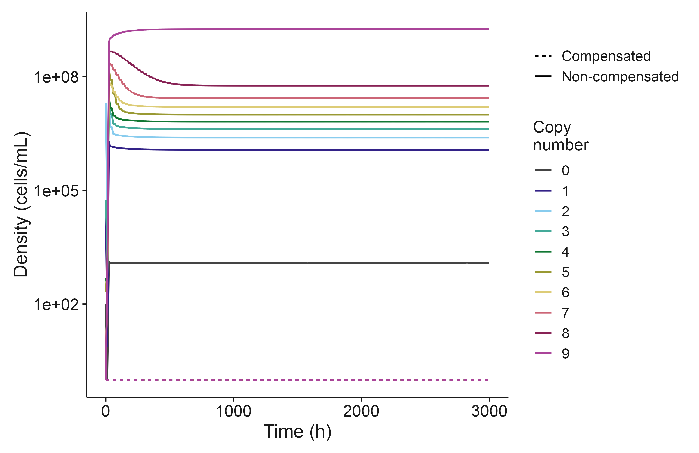
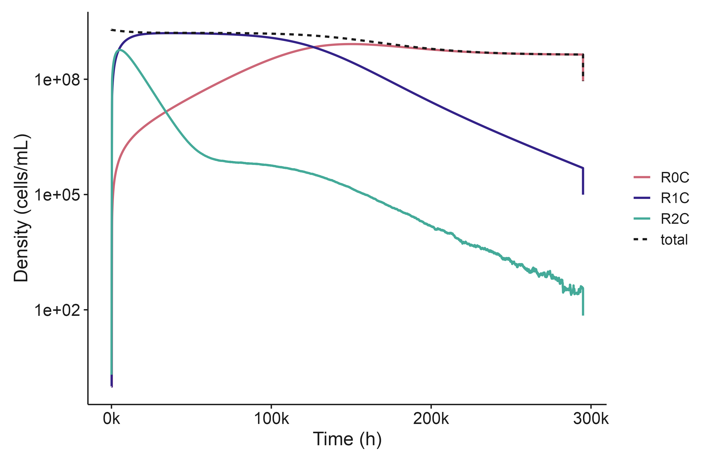
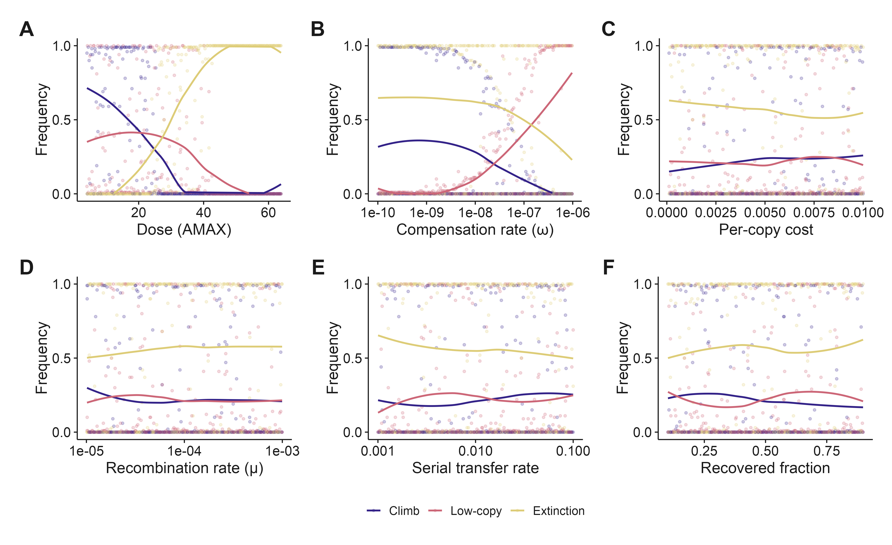

# Overview

This notebook is the entry point of the code for "Unstable Heteroresistance as a Stepping Stone to Stable Resistance via Compensatory Mutations" (Berryhill and Andersson). It contains no functions of its own: it sources the modules in `R/simulation/` and the scripts in `R/figures/` and calls them in order. Knitting it writes

- the seven data figures, `figures/Fig1.png` to `Fig4.png` and `FigS3.png` to `FigS5.png`;
- `source_data/panel_data.rds`, the data frame behind every figure panel;
- the source data workbook, `source_data/Source_Data.xlsx`;
- `session_info.txt`, the versions of R and of the packages in use;
- `SteppingStone.html`, the knitted document, beside this notebook.

Existing files with these names are overwritten.

The notebook has two modes, chosen by the parameter `resimulate`.

- **Default mode** (`resimulate: false`) reads the simulation results shipped in `results/`, classifies the replicates again, and builds the figures and the workbook from them. It runs no stochastic simulation. Knits in this mode took about half a minute on the one machine tested.
- **Re-simulation mode** (`resimulate: true`) first runs every batch behind the figures into the folder `resim_dir`, then builds the figures and the workbook from that folder. This is 42,200 runs of the compiled engine to 300 h (12,000 for the outcome frequencies, 200 for the trajectories of Figure 1 and 30,000 for the sensitivity sweep), 300 runs of the R reference engine to 300 h and 300 runs of the compiled engine to 3,000 h, besides the two runs of the engine verification. Timed once each on the same machine, one run at a time, a compiled run to 300 h took 11 s, an R-reference run to 300 h 126 s and a compiled run to 3,000 h 107 s. The runs of a batch are spread over `n_workers` parallel sessions, 12 on that machine. The batch runner saves a checkpoint after every wave of replicates, so a knit that was interrupted continues from the saved replicates when it is started again with the same `resim_dir`.

| Parameter | Default | Meaning |
|---|---|---|
| `resimulate` | `false` | `false` reads the shipped results; `true` re-runs every batch first |
| `results_dir` | `results` | Folder the shipped results are read from |
| `resim_dir` | `results_resimulated` | Folder a re-simulation writes to. It must not be `results_dir`, because the batch runner resumes from any batch it finds and would run nothing |
| `n_workers` | number of cores minus 2 | Parallel workers of a re-simulation; does not affect any result |

To knit in default mode, call `rmarkdown::render("SteppingStone.Rmd")` with the working directory at this folder. For a re-simulation, call `rmarkdown::render("SteppingStone.Rmd", params = list(resimulate = TRUE))`. All paths are relative to the folder that holds this notebook, which is the working directory of every chunk.

# Setup

The first chunk checks that the packages the modules and the figure scripts use are installed, and stops with a message that names the missing ones if any is not. Nothing is installed from inside the notebook. The compiled engine, the package `hrsim`, is looked for separately: a re-simulation needs it, while default mode only uses it for the engine verification below and skips that section without it. The source package of `hrsim` is `hrsim_0.1.0.tar.gz` in this folder; the notebook does not install it.

```{r setup-packages}
required <- c("ggplot2", "patchwork", "dplyr", "tidyr", "scales", "openxlsx",
              # The PNG device and the font lookup of the figures. The figure
              # scripts would fall back on other ones, and the figures would
              # then not be drawn as the published ones were.
              "ragg", "systemfonts")
# The batch runner and the sweep design are called only in a re-simulation.
if (isTRUE(params$resimulate)) required <- c(required, "future", "furrr", "lhs")
absent <- required[!vapply(required, requireNamespace, logical(1), quietly = TRUE)]
if (length(absent) > 0)
  stop("Install these packages before knitting: ",
       paste(absent, collapse = ", "), call. = FALSE)

HRSIM_AVAILABLE <- requireNamespace("hrsim", quietly = TRUE)
if (isTRUE(params$resimulate) && !HRSIM_AVAILABLE)
  stop("A re-simulation needs the compiled engine. Install the hrsim package ",
       "from hrsim_0.1.0.tar.gz before knitting.", call. = FALSE)
```

The next chunk holds the settings of the simulations: conditions, horizons, output grids, numbers of replicates, the ranges of the sweep and the seeds. They are the settings of the run that produced the shipped results. In default mode they select the stored replicates that are read; in re-simulation mode they define what is run.

```{r setup-settings}
# The three conditions: Scenario 1, Scenario 2 and the control without
# compensation (compensation rate zero).
CONDITIONS <- c("S1", "S2", "omega0")

# Horizons in hours, each with the number of regularly spaced rows an engine
# is asked to record (n_out). Rows at transfers are recorded in addition.
H_SHORT <- 24      ; NOUT_SHORT <- 240     # one transfer interval, 0.1 h grid
H_CLASS <- 300     ; NOUT_CLASS <- 300     # classified at 288 h; 1 h grid
H_LONG  <- 3000    ; NOUT_LONG  <- 250     # 12 h grid

# Numbers of replicates. A batch of n replicates uses the seeds 1 to n, and a
# replicate's random stream depends only on its own seed.
SEEDS_FREQ_CPP <- 4000     # frequency batches, compiled engine
SEEDS_FREQ_R   <- 100      # frequency batches, R reference engine
SEEDS_TRAJ     <- 100      # 300 h trajectory batches
SEEDS_LONG     <- 100      # 3,000 h batches
SWEEP_SETS     <- 300      # parameter sets of the sensitivity sweep
SWEEP_SEEDS    <- 100      # replicates per parameter set

# Conditions that have a frequency batch on the R reference engine, and
# conditions that have a 300 h trajectory batch (Figure 1 uses Scenario 1 and
# the control).
FREQ_R_CONDITIONS <- c("S1", "S2", "omega0")
TRAJ_CONDITIONS   <- c("S1", "omega0")

# Parameters varied in the sensitivity sweep, each with c(min, max) in the
# unit of the argument of make_condition() of the same name. The parameters
# named in SWEEP_LOG are sampled uniformly on a log10 scale, the others on a
# linear scale.
SWEEP_RANGES <- list(
  omega         = c(1e-10, 1e-6),   # compensation rate
  amax          = c(4,     64),     # antibiotic dose
  cost_per_copy = c(1e-4,  1e-2),   # per-copy cost
  mu            = c(1e-5,  1e-3),   # recombination rate
  dil           = c(1e-3,  1e-1),   # serial transfer rate
  comp_frac     = c(0.1,   0.9)     # fraction of the cost compensation recovers
)
SWEEP_LOG <- c("omega", "mu", "dil")

# Master seed. No replicate depends on it, because every replicate is seeded
# with its own seed. The Latin hypercube design of the sweep is drawn with
# set.seed(MASTER_SEED + 7919). Setting a seed here, before any batch, also
# keeps the session on R's default random number generator, with which that
# design is drawn (see sweep_design() in R/simulation/08_notebook.R).
MASTER_SEED <- 20260609
set.seed(MASTER_SEED)

# Largest relative difference accepted between the two engines when the
# random layer is switched off.
DET_RELERR_TOL <- 1e-9
```

The last setup chunk chooses the results folder and sources the code. The simulation modules read the folder from `RESULTS_DIR` and the panel data script from `HR_RESULTS`; both are set to `results_dir` in default mode and to `resim_dir` in a re-simulation, so that everything downstream is built from the same folder. The modules in `R/simulation/` are sourced in file order, then `R/figures/00_style.R`. The other files in `R/figures/` are scripts that do their work when sourced, and each is sourced in its own chunk further down.

```{r setup-modules}
if (!dir.exists(params$results_dir))
  stop("results_dir was not found: ", params$results_dir, call. = FALSE)
if (isTRUE(params$resimulate) &&
    identical(normalizePath(params$resim_dir, mustWork = FALSE),
              normalizePath(params$results_dir, mustWork = FALSE)))
  stop("resim_dir must not be results_dir: the batch runner would resume ",
       "from the shipped batches and run nothing.", call. = FALSE)

# Read by 00_config.R, which keeps a value assigned before it is sourced.
RESULTS_DIR <- if (isTRUE(params$resimulate)) params$resim_dir else
  params$results_dir
N_WORKERS   <- params$n_workers
# Without hrsim the R reference becomes the active engine, so that
# 07_engines.R can be sourced; default mode runs no batch.
USE_ENGINE  <- if (HRSIM_AVAILABLE) "cpp" else "R"

# Read by R/figures/01_panel_data.R and R/figures/source_data.R. The run
# dates shown in the workbook are those listed beside the results in use.
HR_RESULTS            <- RESULTS_DIR
SOURCE_DATA_RUN_DATES <- file.path(RESULTS_DIR, "run_dates.csv")

for (module in c("00_config.R", "01_parameters.R", "02_transitions.R",
                 "03_engine_R.R", "04_classify.R", "05_run.R",
                 "06_sensitivity.R", "07_engines.R", "08_notebook.R"))
  source(file.path("R", "simulation", module))
source(file.path("R", "figures", "00_style.R"))
```

# Model

This chunk builds the three conditions with `make_condition()` and prints their parameter values; these are the conditions a re-simulation runs. Supplementary Table 2 of the workbook reports the same values for Scenario 1 and Scenario 2; its tab is written from `make_condition()` as well. The first table holds the scalar parameters, one row per condition. The second holds the founder densities (`y0`, cells per mL) and the per-state parameters, one row per state; a parameter that differs between conditions has one column per condition. Symbols and units are given where each parameter is set, in `R/simulation/01_parameters.R`.

```{r data-parameters}
conditions <- lapply(setNames(nm = CONDITIONS), make_condition)
parameter_tables <- condition_tables(conditions)
knitr::kable(parameter_tables$scalars)
knitr::kable(parameter_tables$by_state)
```

# Engine verification

This chunk compares the R reference engine with the compiled engine while the random layer is switched off, so that both integrate the same deterministic equations and their results can be compared number by number. It reports the largest relative error over all 25 output columns and every recorded row. In default mode the comparison runs to 24 h, which keeps the knit short, and its result is only reported. In re-simulation mode it runs to 300 h, the simulated time of the classified batches, and the knit halts if the largest relative error exceeds the tolerance of 1e-9, because every compiled batch that follows depends on the compiled engine reproducing the reference; the result is then also saved in `resim_dir`. The value printed below is the one obtained in this knit. The Methods of the paper report the value obtained on the machine that ran the published simulations. The engines are called with seed 1, which has no effect on a run without the random layer. If `hrsim` is not installed, default mode skips the comparison with a message.

```{r sim-engine-verification}
if (HRSIM_AVAILABLE) {
  gate <- engine_gate(
    t_end  = if (isTRUE(params$resimulate)) H_CLASS else H_SHORT,
    n_out  = if (isTRUE(params$resimulate)) NOUT_CLASS else NOUT_SHORT,
    tol    = DET_RELERR_TOL,
    halt   = isTRUE(params$resimulate),
    record = if (isTRUE(params$resimulate))
      file.path(RESULTS_DIR, "engine_verification.rds"))
  cat(sprintf(paste0("R reference against compiled engine, random layer off, ",
                     "0 to %g h, %d columns, %d rows:\n",
                     "maximum relative error %.3e (tolerance %.1e, %s)\n"),
              gate$t_end, gate$n_columns, gate$n_rows, gate$relerr, gate$tol,
              if (isTRUE(gate$pass)) "within tolerance" else "above tolerance"))
} else {
  message("The hrsim package is not installed: the engine verification is ",
          "skipped. The figures and the workbook do not depend on it.")
}
```

# Simulations

The first four chunks of this section each handle one family of batches, through `load_or_run_batch()` or, for the sweep, `sensitivity_sweep()`. In default mode the batch is read from `results_dir` and nothing is written. In re-simulation mode the batch is run into `resim_dir`. In both modes every replicate is then classified on its transfer rows as extinction, climb or low-copy; classifications are not shipped, so default mode computes them from the stored replicates. A replicate is identified by its seed, and its random stream depends only on that seed, not on the number of workers or on the order in which replicates finish.

The frequency batches give the outcome frequencies of each condition. Each condition has 4,000 replicates on the compiled engine (seeds 1 to 4,000) and 100 replicates on the R reference engine (seeds 1 to 100), all run to 300 h and stored on their 12 transfer rows, from 24 h to 288 h. The chunk ends with the summary of frequencies and 95% Clopper-Pearson intervals, rounded to three decimals, from which Fig 1C is drawn. A re-simulation writes that summary to `frequency_summary.rds` in `resim_dir`; default mode leaves the stored summary as it is, and the next section compares the two.

```{r sim-frequency-batches, message = NA}
# Chunk option message = NA: the progress messages of the batch runner, one
# per wave of replicates, go to the console and not into the knitted document.
# Seeds: 1 to SEEDS_FREQ_CPP (4,000) on the compiled engine and 1 to
# SEEDS_FREQ_R (100) on the R reference engine, for each condition.
freq_batches <- list()
for (sc in CONDITIONS) {
  freq_batches[[sc]]$cpp <- load_or_run_batch(
    sc, paste0(sc, "_freq_cpp"), t_end = H_CLASS,
    seeds = seq_len(SEEDS_FREQ_CPP), keep = "cycle_end", engine = "cpp",
    resimulate = isTRUE(params$resimulate))
  if (sc %in% FREQ_R_CONDITIONS)
    freq_batches[[sc]]$R <- load_or_run_batch(
      sc, paste0(sc, "_freq_R"), t_end = H_CLASS,
      seeds = seq_len(SEEDS_FREQ_R), keep = "cycle_end", engine = "R",
      resimulate = isTRUE(params$resimulate))
}
FREQ <- frequency_summary(
  freq_batches,
  save_path = if (isTRUE(params$resimulate))
    file.path(RESULTS_DIR, "frequency_summary.rds"))
```

The trajectory batches are the source of Figure 1A, 1B and 1D: 100 replicates (seeds 1 to 100) of Scenario 1 and of the control, run to 300 h on the compiled engine and recorded at 0 h and at each of the 12 transfers.

```{r sim-trajectory-batches, message = NA}
# Chunk option message = NA: the progress messages of the batch runner go to
# the console and not into the knitted document.
# Seeds: 1 to SEEDS_TRAJ (100) for each of the two conditions.
traj_batches <- list()
for (sc in TRAJ_CONDITIONS)
  traj_batches[[sc]] <- load_or_run_batch(
    sc, paste0(sc, "_traj300"), t_end = H_CLASS,
    seeds = seq_len(SEEDS_TRAJ), keep = "all", engine = "cpp",
    resimulate = isTRUE(params$resimulate))
```

The 3,000 h batches are the source of Figures 2, 3A and 3B and of Supplementary Fig. 3: 100 replicates (seeds 1 to 100) of each condition on the compiled engine, recorded every 12 h and at every transfer.

```{r sim-long-batches, message = NA}
# Chunk option message = NA: the progress messages of the batch runner go to
# the console and not into the knitted document.
# Seeds: 1 to SEEDS_LONG (100) for each condition.
long_batches <- list()
for (sc in CONDITIONS)
  long_batches[[sc]] <- load_or_run_batch(
    sc, paste0(sc, "_long"), t_end = H_LONG,
    seeds = seq_len(SEEDS_LONG), keep = "all", n_out = NOUT_LONG,
    engine = "cpp", resimulate = isTRUE(params$resimulate))
```

The sensitivity sweep is the source of Figure 4 and Supplementary Fig. 5. Its design is a Latin hypercube of 300 parameter sets over the six ranges set above, drawn with the seed `MASTER_SEED + 7919`, which is 20268528. Each set is run under Scenario 1 for 100 replicates (seeds 1 to 100) to 300 h on the compiled engine and reduced to the frequencies of the three outcomes. PAWN indices then measure how strongly each parameter shifts the distribution of each frequency. In default mode the stored sweep table and PAWN table are read.

```{r sim-sweep, message = NA}
# Chunk option message = NA: the progress messages of the sweep, one per
# parameter set and per wave of replicates, go to the console and not into the
# knitted document.
# Seeds: MASTER_SEED + 7919 for the design, and 1 to SWEEP_SEEDS (100) for
# the replicates of every parameter set.
SWEEP <- sensitivity_sweep(
  n_sets = SWEEP_SETS, seeds_per_set = SWEEP_SEEDS,
  ranges = SWEEP_RANGES, log = SWEEP_LOG,
  design_seed = MASTER_SEED + 7919L,
  resimulate = isTRUE(params$resimulate))
```

The series behind Supplementary Fig. 4 is not one of these batches: its data come from an old iteration of the model which is not regenerated by this code. In both modes that figure is drawn from the files in `results/long_run/`.

The workbook shows, on every tab, the date on which the code behind it was run. This chunk prints the table of those dates. In default mode it is `run_dates.csv` of the shipped results. In re-simulation mode the dates are taken from the manifest of that run, to which the batch runner adds a row at every call, and written to `run_dates.csv` in `resim_dir`; the sweep, which has no manifest row, is dated by the file in which its progress is saved.

```{r data-run-dates}
if (isTRUE(params$resimulate))
  resim_run_dates(manifest = MANIFEST, sweep_checkpoint = SWEEP$checkpoint,
                  shipped = file.path(params$results_dir, "run_dates.csv"),
                  path = SOURCE_DATA_RUN_DATES)
print(read.csv(SOURCE_DATA_RUN_DATES, stringsAsFactors = FALSE),
      row.names = FALSE)
```

# Results in brief

This chunk prints the outcome frequencies of each condition on both engines: the number of replicates with each outcome, the percentage, and the bounds of the 95% Clopper-Pearson interval in percent. It then lists, for each condition and outcome, whether the interval of the compiled engine and that of the R reference overlap. In default mode it also states whether the tables computed here from the stored replicates equal the stored summary that Fig 1C is drawn from.

```{r data-frequencies}
for (sc in CONDITIONS) {
  cat(sprintf("\n%s, compiled engine, %d replicates\n", sc,
              nrow(freq_batches[[sc]]$cpp$cls)))
  print(FREQ[[sc]]$cpp, row.names = FALSE)
  if (!is.null(FREQ[[sc]]$R)) {
    cat(sprintf("%s, R reference engine, %d replicates\n", sc,
                nrow(freq_batches[[sc]]$R$cls)))
    print(FREQ[[sc]]$R, row.names = FALSE)
  }
}
cat("\nIntervals of the two engines\n")
print(interval_overlap(FREQ), row.names = FALSE)
if (!isTRUE(params$resimulate)) {
  stored <- readRDS(file.path(RESULTS_DIR, "frequency_summary.rds"))
  cat("\nTables equal to those of the stored frequency_summary.rds:",
      same_frequency_tables(FREQ, stored), "\n")
}
```

This chunk prints the PAWN indices of the sweep for the frequency of each outcome: for every parameter, the median and the maximum, over eight quantile bins of the parameter, of the Kolmogorov-Smirnov distance between the distribution of the frequency within a bin and its distribution over all sets.

```{r data-pawn}
SWEEP$pawn
```

# Figures

The figures and the workbook are drawn from one set of data frames, so a panel and its tab cannot disagree. This chunk sources `R/figures/01_panel_data.R`, which reads the results folder chosen above, computes the 17 panel data frames and writes them to `source_data/panel_data.rds`. It then calls `check_long_run_reduction()`, which reduces the raw series behind Supplementary Fig. 4 to one row per 24 h cycle again and stops if any value differs from the shipped reduction, from which the figure is drawn, by more than 1e-12 in relative terms.

```{r fig-panel-data}
source("R/figures/01_panel_data.R")
check_long_run_reduction()
```

Each of the following chunks sources the script of one figure, which reads its panel data frames, draws the figure and saves it as a PNG file in `figures/`, and then shows that file. The scripts also try to save a PDF copy and skip it where R has no working PDF device of the kind they use.

Figure 1 shows the outcomes of selection under Scenario 1: the mean copy number of one replicate that climbs to high copy number (A, seed 2) and of one that stays at low copy number (B, seed 7), the frequency of each outcome among the 4,000 compiled replicates with 95% Clopper-Pearson intervals (C), and, for the control without compensation, the share of each non-compensated state in the population at 288 h (D).

```{r fig-1, message = FALSE}
# Chunk option message = FALSE: the save helper reports the file it wrote and,
# where the PDF copy is skipped, the reason given by R's PDF device, which can
# name a folder of the local R installation. These messages are left out of
# the knitted document.
source("R/figures/fig1.R")

```

Figure 2 shows the dynamics under Scenario 1, from the 100 replicates of the 3,000 h batch: the mean density of the states over the replicates, to 72 h (A), 1,000 h (B) and 3,000 h (C), and, to 3,000 h, the mean density of each compensated state divided by the total mean density of the population (D).

```{r fig-2, message = FALSE}
# Chunk option message = FALSE: the messages of the save helper, which can
# name a folder of the local R installation, are left out of the knitted
# document.
source("R/figures/fig2.R")

```

Figure 3 shows Scenario 2. Panels A and B are computed from the mean densities of the states over the 100 replicates of the 3,000 h batches: the mean copy number of those mean densities against time, for both scenarios (A), and, for Scenario 2, the mean density of each compensated state divided by the total mean density of the population (B). Panel C is the net growth rate of each compensated state at the treatment dose, computed from the parameters.

```{r fig-3, message = FALSE}
# Chunk option message = FALSE: the messages of the save helper, which can
# name a folder of the local R installation, are left out of the knitted
# document.
source("R/figures/fig3.R")

```

Figure 4 shows the PAWN indices of the six swept parameters for the frequency of the climb outcome (A), the low-copy outcome (B) and extinction (C): the bar is the median over the quantile bins and the tick the maximum.

```{r fig-4, message = FALSE}
# Chunk option message = FALSE: the messages of the save helper, which can
# name a folder of the local R installation, are left out of the knitted
# document.
source("R/figures/fig4.R")

```

Supplementary Fig. 3 shows the control without compensation: the mean density of each of the 20 states over the 100 replicates of the 3,000 h batch.

```{r fig-s3, message = FALSE}
# Chunk option message = FALSE: the messages of the save helper, which can
# name a folder of the local R installation, are left out of the knitted
# document.
source("R/figures/figS3.R")

```

Supplementary Fig. 4 shows the densities of the three lowest-copy compensated states and of the total population, one point per 24 h cycle. Its data come from an old iteration of the model which is not regenerated by this code.

```{r fig-s4, message = FALSE}
# Chunk option message = FALSE: the messages of the save helper, which can
# name a folder of the local R installation, are left out of the knitted
# document.
source("R/figures/figS4.R")

```

Supplementary Fig. 5 shows the sweep itself: the frequency of each outcome in each of the 300 parameter sets against each of the six parameters, with a loess curve per outcome.

```{r fig-s5, message = FALSE, warning = FALSE}
# Chunk option message = FALSE: the messages of the save helper, which can
# name a folder of the local R installation, are left out of the knitted
# document.
# Chunk option warning = FALSE: drawing this figure raises two warnings from
# ggplot2, "Removed 71 rows containing missing values or values outside the
# scale range (`geom_smooth()`)" and the same with 23 rows. The y axis is
# limited to the range of a frequency, 0 to 1, and the loess curves of panel A
# (71 fitted values) and panel B (23 fitted values) pass outside that range;
# ggplot2 drops those fitted values and draws the line through the rest. No
# data point is removed. This is how the published figure is drawn, as
# R/figures/figS5.R explains, so the two warnings are expected and are left
# out of the knitted document. The counts are those of the shipped sweep.
source("R/figures/figS5.R")

```

# Source data

This chunk sources `R/figures/source_data.R`, which writes `source_data/Source_Data.xlsx`: an Index tab and one tab per figure panel and supplementary table, each with the date the code was run, the question the panel answers and the data. The plotted values are the panel data frames the figures are drawn from.

```{r data-source-data}
source("R/figures/source_data.R")
```

# Session information

This chunk prints the versions of R and of the packages in use and writes the same text to `session_info.txt`, so that a reader whose output differs can compare their installation with the one that produced these files.

```{r data-session-info}
session <- sessionInfo()
writeLines(capture.output(print(session)), "session_info.txt")
session
```
